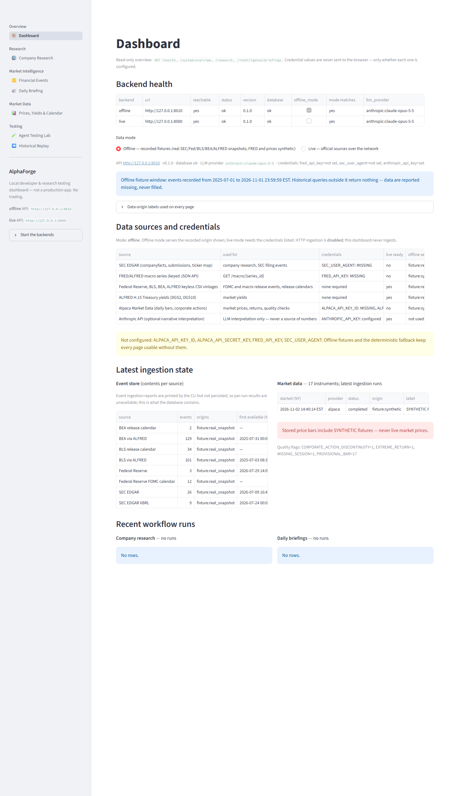
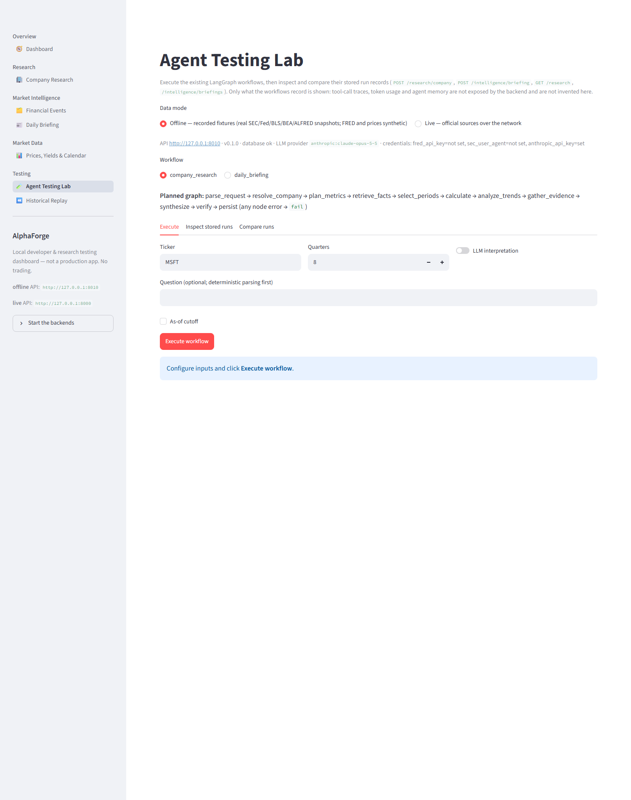

# Agent Testing Dashboard (Streamlit)

A **local** dashboard for exploring, running, inspecting and comparing every implemented AlphaForge
capability (v0.1 research, v0.2 market intelligence, v0.3-A market data) through the real FastAPI
application. It is not a production app. It does not deploy, trade or ingest, and it adds no
financial, event or market logic: every number, ranking, adjustment and visibility decision comes
from the backend.



## Installation

Streamlit is in an optional `ui` dependency group, which `uv sync` installs by default
(`[tool.uv] default-groups = ["dev", "ui"]`). The core package does not depend on it.

```powershell
uv sync                      # dev + ui groups
uv sync --no-group ui        # core + dev only (dashboard unavailable)
```

## Starting it (Windows)

### One command

```powershell
powershell -ExecutionPolicy Bypass -File scripts\start_dashboard.ps1 -Ingest
```

This runs `uv sync` and `init-db`. With `-Ingest`, it loads the recorded offline fixtures, which is
idempotent. It then starts the offline API on 127.0.0.1:8000 and the dashboard on 127.0.0.1:8501.
Press Ctrl+C to stop both. Leave out `-Ingest` once the database is populated.

### Step by step (two terminals)

```powershell
uv sync
uv run python -m finance_agent init-db
uv run python -m finance_agent events ingest --offline                                  # real snapshots
uv run python -m finance_agent market ingest --start 2024-01-02 --end 2026-10-30 --offline  # SYNTHETIC prices, real yields
uv run python -m finance_agent serve --offline --port 8000                               # terminal 1
uv run python -m finance_agent.ui                                                        # terminal 2 → http://127.0.0.1:8501
```

Everything starts through `uv run python -m …`. On machines with Windows Application Control,
the `.venv\Scripts\*.exe` shims (`finance-agent.exe`, `streamlit.exe`, `pytest.exe`) may be
blocked. `python -m finance_agent.ui` always binds `127.0.0.1`. The port comes from
`ALPHAFORGE_UI_PORT` (default 8501). `uv run python -m streamlit run apps/ui/app.py` also works,
and it is bound to localhost by `.streamlit/config.toml`.

| Service | Command | Binds |
|---|---|---|
| Offline API (recorded fixtures) | `uv run python -m finance_agent serve --offline --port 8000` | 127.0.0.1:8000 |
| Live API (optional) | `$env:SEC_USER_AGENT="Name email"; uv run python -m finance_agent serve --port 8001` | 127.0.0.1:8001 |
| Dashboard | `uv run python -m finance_agent.ui` | 127.0.0.1:8501 |

Backend URLs come only from environment variables, never from the browser:

- `ALPHAFORGE_API_URL`: offline backend, default `http://127.0.0.1:8000`.
- `ALPHAFORGE_LIVE_API_URL`: live backend, default `http://127.0.0.1:8001`.

Non-loopback hosts, credentials in the URL, queries and fragments are rejected. If port 8000 is
already taken, for example by another `serve` process, start the offline API on another port and
set `ALPHAFORGE_API_URL` to match. The Dashboard page shows the reachability and mode of both
backends.

Offline and live servers share `DATABASE_URL` unless you set it per process. Every record carries
its `data_origin`, so mixed data is labelled. A separate database for offline work keeps fixture
data apart; set `$env:DATABASE_URL="sqlite:///data/offline.db"` for both the ingest and the server.

## Data modes and origin labels

Offline and live are **server-level** settings. The dashboard selects one of two configured
backends and **refuses to send requests** when `/health.offline_mode` disagrees with the selection,
so an offline server can never be presented as live.

| Origin | Banner |
|---|---|
| `live` | green: LIVE, retrieved from the official source |
| `fixture:real_snapshot` | blue: HISTORICAL REAL SNAPSHOT (SEC, Fed, BLS, BEA, ALFRED events and Treasury yields) |
| `fixture:synthetic` (or any mix that includes it) | red: SYNTHETIC FIXTURE, NOT real findings (FRED series and **all offline prices**) |
| missing / unknown | amber: MISSING / UNVERIFIED ORIGIN |

Price views additionally show a red **SYNTHETIC PRICE DATA, NOT market prices** banner whenever any
returned bar is synthetic. Exported reports (Markdown and JSON) are prefixed with the origin label.

## Sections and backend mapping

| Section | What you can do | API calls |
|---|---|---|
| **Dashboard** | Check the health of both backends; see data sources and whether each credential is configured (never its value); view event-store contents per source, latest market ingestion runs and quality counts, and recent research and briefing runs with verification status | `GET /health`, `GET /system/overview`, `GET /research`, `GET /intelligence/briefings` |
| **Company Research** | Enter a ticker, quarters and an optional as-of cutoff, with LLM on or off; view fundamentals, calculations and trend charts (revenue, margins, CAPEX, FCF); read the report; inspect sources, calculations, missing data and warnings; **export** the report as Markdown or the run as JSON | `GET /companies/{t}`, `GET /companies/{t}/financials`, `POST /research/company` |
| **Market Intelligence: Financial Events** | Set date range and cutoff; filter by category, subtype, source, ticker and importance; open event details with importance components, sources, revisions and economic-channel hypotheses; the SCHEDULED calendar is shown separately from occurred events | `GET /events`, `GET /events/{id}?as_of=`, `GET /events/calendar` |
| **Market Intelligence: Daily Briefing** | Generate a briefing (date, cutoff, window, limits, tickers, LLM) or load a stored one; view ranked entries, importance, sources and verification; upcoming releases are labelled "not occurred"; **export** | `POST /intelligence/briefing`, `GET /intelligence/briefings[/{id}]` |
| **Market Data** | Prices (instrument, range, **explicit basis** raw / split_adjusted / total_return, point-in-time cutoff or retrospective research mode, provisional toggle); returns (simple or log), cumulative return, drawdown and rolling volatility, all computed server-side; Treasury yields with vintage cutoff and bp changes; XNYS session lookup and event-time alignment (manual time or an event id); data-quality flags and runs | `GET /market/instruments`, `/market/prices/{t}`, `/market/returns/{t}`, `/market/yields/{s}`, `/market/calendar`, `/market/quality` |
| **Agent Testing Lab** | Pick a workflow (from `GET /workflows`), configure inputs and **execute** it; view round-trip time (measured by the dashboard), per-node status and times (recorded by the workflow), errors, structured output, verification and sources; **inspect** stored runs; **compare** two stored runs side by side (status, verification, LLM, cutoff, origin, values by metric and period, briefing clusters) | `POST /research/company`, `POST /intelligence/briefing`, `GET /research[/{id}]`, `GET /intelligence/briefings[/{id}]` |
| **Historical Replay** | Run a single-cutoff event visibility audit (visible, excluded-future, no-availability-time, calendar knowledge); **compare two cutoffs** for event visibility, company financials, point-in-time prices or yield vintages, with a point-in-time integrity check per cutoff | `GET /events/replay`, `/companies/{t}/financials?as_of=`, `/market/prices/{t}?as_of=`, `/market/yields/{s}?as_of=` |



### What is deliberately not shown

- **Tool-call traces, token usage, agent memory.** The backend does not expose them, and the Lab
  says so instead of inventing them.
- **Event ingestion history.** Event ingestion reports are printed by the CLI and not persisted.
  The Dashboard shows store contents per source and says per-run results are unavailable. Market
  ingestion runs *are* persisted and shown.
- **Historical source availability beyond what the API returns.** Two-cutoff comparisons only
  align records the API returned at each cutoff. The integrity check compares each record's
  `available_at` with the cutoff **echoed back by the server**, which also checks that the cutoff
  propagated.

## API additions (read-only, backward compatible)

- `GET /system/overview` (new, `interfaces/system_api.py`) returns:
  - the source catalogue, with each needed credential as `{env_var, configured: bool}`;
  - `live_ready` and the offline origin for each source;
  - event-store counts and availability range per source;
  - the five latest market ingestion runs, with errors passed through `redact`;
  - quality-flag counts;
  - research and briefing counts by status;
  - whether HTTP ingestion is enabled (a boolean).

  It never fetches from a provider or writes. `/health.credentials_configured` is unchanged; the
  v0.1 contract is kept.
- From the earlier console branch:
  - `GET /events/replay`;
  - `GET /events/{id}?as_of=`;
  - the `subtype` filter on `/events`;
  - `GET /research`, `GET /intelligence/briefings` and `GET /workflows`;
  - `as_of` and `params` on run outputs;
  - `fixture_event_window` on `/health`;
  - `started_at` and `finished_at` recorded per workflow node (observability only).

The `/market/*` routes return plain dicts. The dashboard's client pins the fields it renders with
small Pydantic models (`PricesOut`, `ReturnsOut`, `YieldsOut`, `CalendarOut`, `QualityOut`,
`InstrumentsOut`), so contract drift surfaces as a readable `contract` error.

## Security

- The dashboard (`python -m finance_agent.ui`, `.streamlit/config.toml`) and the API both bind to
  `127.0.0.1`. Usage statistics are off and XSRF protection is on.
- Requests go only to loopback backends taken from the environment, with explicit timeouts and no
  redirects.
- No credential values reach the browser. `/health` and `/system/overview` return booleans and
  environment-variable names only; a test sets fake secrets and checks they are absent from
  `/health`, `/system/overview` and `/openapi.json`.
- There is no shell access, no CLI subprocess, no ingestion, no destructive database operation and
  no admin-token handling. The `POST` ingest routes stay disabled unless `INGEST_ADMIN_TOKEN` is
  set, and the dashboard never calls them.
- Public deployment is out of scope.

## Tests

```powershell
uv run python -m pytest tests/ui tests/integration/test_system_overview.py tests/historical_replay/test_replay_audit.py
```

- `tests/ui/test_client.py`: mocked HTTP for parsing, parameters (basis, mode, cutoff,
  provisional), 4xx/422/5xx, non-JSON bodies, contract drift, unreachable hosts, timeouts,
  redirects and the host allow-list.
- `tests/ui/test_validation_labels.py`, `tests/ui/test_compare.py`: input validation (ticker,
  quarters, cutoffs, bounded market ranges, ids), origin labels, two-cutoff diff and integrity
  helpers, and display-safe tables.
- `tests/ui/test_pages.py`, `tests/ui/test_dashboard.py`: Streamlit `AppTest` against the **real API
  on a loopback port**. The database is ingested from recorded fixtures, including SYNTHETIC
  NVDA/SPY bars and real 2026 yields. They cover:
  - every page and the navigation entry point;
  - Dashboard credential and missing-credential display;
  - synthetic price labels and the explicit price basis;
  - point-in-time cutoff propagation and retrospective research mode;
  - returns, yields, calendar alignment and quality flags;
  - Lab execution of both workflows with timing, a recorded failed run, invalid input, and
    comparison of runs at different cutoffs;
  - two-cutoff replay for events, financials, prices and yields;
  - report export buttons;
  - the unreachable live backend, mode mismatch and remote-URL rejection.
- `tests/integration/test_system_overview.py`: overview contents, no secret leakage, and the
  launcher binding only to loopback.

## Manual acceptance tests

Run these against the offline API with the fixtures ingested.

| # | Section | Steps | Expected |
|---|---|---|---|
| 1 | Dashboard | Open http://127.0.0.1:8501 | The offline backend is reachable and its mode matches. An absent live backend shows "reachable: no", not an exception. |
| 2 | Dashboard | Look at **Data sources and credentials** | Each env var shows `configured` or `MISSING`, with no values. Alpaca shows offline label SYNTHETIC, SEC shows HISTORICAL REAL SNAPSHOT. |
| 3 | Dashboard | Look at **Latest ingestion state** | The event store lists sources with counts. The market run shows `fixture:synthetic` and a red synthetic warning. |
| 4 | Company Research | MSFT, 8 quarters, **Run company research** | Report, verification banner, charts, sources; `llm.status` is `unavailable` or `failed` without credit. **Download report** produces Markdown that starts with the origin label. |
| 5 | Company Research | Set the cutoff to 2025-06-30 and rerun | Periods end before the cutoff. The report's `as_of` equals 2025-06-30 23:59:59 New York. |
| 6 | Financial Events | Range 2026-10-01 → 2026-11-01; filter MACRO_RELEASE, HIGH | Only matching events appear. Event detail shows the importance components and source links. The calendar expander says "SCHEDULED, not occurred". |
| 7 | Daily Briefing | Date 2026-10-28, **Generate briefing** | Status completed, verification shown, entries ranked, upcoming releases labelled not occurred, export available. |
| 8 | Market Data → Prices | NVDA, split_adjusted, **Load prices** | Red SYNTHETIC PRICE DATA banner. "Price basis: `split_adjusted`" is shown. The chart and bars include version, availability and origin. |
| 9 | Market Data → Prices | Point-in-time cutoff 2026-06-30 | The last session is on or before 2026-06-30, and every bar's `available_at` is at or before the cutoff. |
| 10 | Market Data → Prices | Query mode `research` | No cutoff input; an amber RETROSPECTIVE statement. |
| 11 | Market Data → Returns / Yields / Calendar / Quality | Use each button | Returns and volatility come from the server. Yields carry the real-snapshot label and null days are reported. Thanksgiving 2026 is not a session, and 14:00 New York aligns to REGULAR. Quality flags are listed. |
| 12 | Agent Testing Lab | company_research, MSFT, **Execute workflow** | Round-trip time, a node table with recorded times, and structured output. |
| 13 | Agent Testing Lab | Ticker ZZZZQ | A failed run with its error message; nodes after the failure show "not executed". |
| 14 | Agent Testing Lab → Compare | Two MSFT runs at different cutoffs | The summary marks `as_of` as differing, and the values table marks differences. |
| 15 | Historical Replay | Single cutoff 2026-10-28 | Integrity success; visible, excluded-future and calendar tables. |
| 16 | Historical Replay → Compare | Events 2026-10-14 vs 2026-10-28; yields DGS10 2026-10-15 vs 2026-10-30 | Both cutoffs pass integrity, and later records are marked "only at B". |
| 17 | Security | `netstat -ano \| findstr LISTEN` | 8000 and 8501 are listening on 127.0.0.1 only. |

## Known limitations

- **Live mode:** live mode needs a second API process (`--port 8001`, `SEC_USER_AGENT`; Alpaca
  keys for live prices). Live research, live briefings, live Alpaca and live LLM synthesis were
  **not exercised** through the dashboard: Alpaca credentials are absent and Anthropic has no
  credit.
- **Synchronous calls:** research and briefing endpoints are synchronous. The client waits up to
  600 s, with no progress streaming or cancellation.
- **Tracing:** per-node tool/HTTP calls, token usage and agent memory are not traced. Per-node
  timestamps exist only for runs made after the console change. Round-trip time is measured by
  the dashboard client.
- **Event ingestion history:** event ingestion runs are not persisted. The Dashboard shows store
  contents instead.
- **Event calendar listing:** the calendar listing on the Financial Events page is not
  cutoff-filtered. Use Historical Replay for knowledge-time views.
- **Macro series:** `GET /macro` (synthetic FRED offline) and `GET /market/correlations` are not
  surfaced on a page.
- **Screenshots:** only two pages are shown. The headless-Edge captures render page shells, but
  tab contents and button results need a live browser session. The `AppTest` suite is the
  rendering evidence for the other views.
